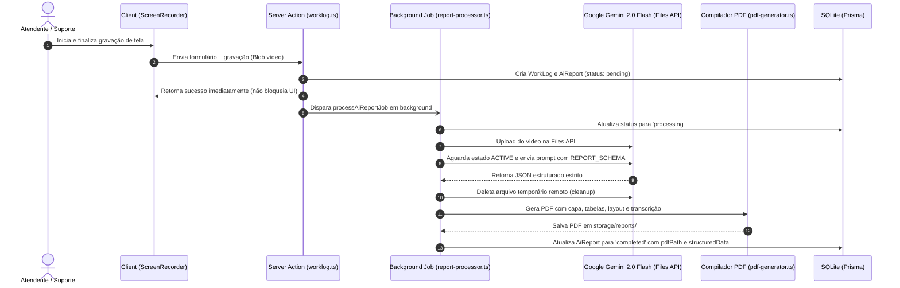

# Pipeline de Geração de Relatórios Técnicos (Gemini & PDFKit)

Este documento instrui agentes e desenvolvedores sobre a arquitetura e manutenção da pipeline de geração de relatórios técnicos automatizados do HubSupport.

---

## 1. Visão Geral da Pipeline

A pipeline é composta por 4 fases consecutivas:
1. **Captura Client-Side:** Gravação sincronizada de tela + áudio (sistema + microfone) no navegador.
2. **Persistência Segura & Job Background:** Armazenamento do arquivo de vídeo no servidor privado e disparo assíncrono.
3. **Análise Multimodal Estruturada:** Envio à Files API do Gemini, polling de status, geração JSON estrita e exclusão do vídeo remoto.
4. **Renderização Vetorial PDF:** Compilação do documento formal em PDF via PDFKit e disponibilização para download autenticado.



---

## 2. Captura no Navegador (`ScreenRecorderButton.tsx`)
- **APIs Nativas:** `navigator.mediaDevices.getDisplayMedia` (vídeo e áudio da tela) e `navigator.mediaDevices.getUserMedia` (microfone).
- **Mixagem com Web Audio API:**
  - Cria `AudioContext`.
  - Conecta `displayStream` e `micStream` em `createMediaStreamSource`.
  - Direciona para `createMediaStreamDestination`.
  - Insere o track mixado no `MediaStream` final para gravar simultaneamente o áudio da aplicação e a voz do atendente.
- **MIME Types Suportados:**
  - Preferencial: `video/webm;codecs=vp9,opus` ou `video/webm`.
  - Fallback: `video/mp4;codecs=avc1,mp4a.40.2`.

---

## 3. Integração com Google Gemini (`src/lib/gemini.ts`)
- **SDK Utilizada:** `@google/genai` (^2.30.0).
- **Modelo Principal:** `gemini-2.0-flash` (ou `gemini-3.8-flash` configurado via `GEMINI_MODEL`).
- **Ciclo na Files API:**
  ```typescript
  // 1. Upload do arquivo local
  const uploadResult = await ai.files.upload({
    file: videoFilePath,
    config: { mimeType },
  });

  // 2. Polling ativo até estado ACTIVE (max 30 tentativas x 2s = 60s)
  let fileInfo = await ai.files.get({ name: uploadResult.name });
  while (fileInfo.state === "PROCESSING") {
    await sleep(2000);
    fileInfo = await ai.files.get({ name: uploadResult.name });
  }

  // 3. Chamada com schema estruturado estrito
  const response = await ai.models.generateContent({
    model,
    contents: [createPartFromUri(fileUri, mimeType), prompt],
    config: {
      responseMimeType: "application/json",
      responseSchema: REPORT_SCHEMA,
      temperature: 0.2,
    },
  });

  // 4. LIMPEZA OBRIGATÓRIA no bloco finally
  await ai.files.delete({ name: uploadResult.name });
  ```

---

## 4. Estrutura do Schema JSON (`REPORT_SCHEMA`)
Campos obrigatórios extraídos pela IA:
- `title` & `subtitle`: Identificação formal do atendimento.
- `department`, `participants`, `platformAnalyzed`: Metadados operacionais.
- `executiveSummary`: Parágrafo condensado formal.
- `proposals`: Array de itens técnicos com `item`, `description`, `category` e `priority` ("Alta", "Média", "Baixa").
- `detailingTopic` & `detailingParagraphs`: Explicação aprofundada dos impactos operacionais e justificativa técnica.
- `referrals`: Próximos passos e encaminhamentos acordados.
- `transcript`: Transcrição cronológica com `speaker`, `role`, `timestamp` ([MM:SS]) e `text`.

---

## 5. Compilação de PDF (`src/lib/pdf-generator.ts`)
- **Motor:** `pdfkit` (^0.20.2).
- **Diretório de Destino:** `storage/reports/` (privado).
- **Padrão Estético e Layout:**
  - Formato A4 com margens corporativas (50pt).
  - Barra de destaque vertical azul (`#2563eb`) no título.
  - Caixa cinza de Resumo Executivo com preenchimento `#f8fafc`.
  - Tabela com cabeçalho azul-escuro (`#0f172a`), linhas zebradas e badges de prioridade coloridos (Alta = Vermelho, Média = Amarelo, Baixa = Verde).
  - Paginação automática dinâmica calculando altura dos blocos de transcrição para evitar quebra de página incorreta.
  - Rodapé em todas as páginas com "Página X de Y" e carimbo de geração institucional.

---

## 6. Tratamento de Erros e Retentativas
- Se o processamento falhar (cota esgotada, arquivo corrompido, timeout), o status em `AiReport` vai para `failed` com `errorMessage` amigável.
- A Server Action `retryAiReport(workLogId)` valida se o vídeo ainda está íntegro no disco e reinicia o job sem recriar o atendimento ou perder dados.
