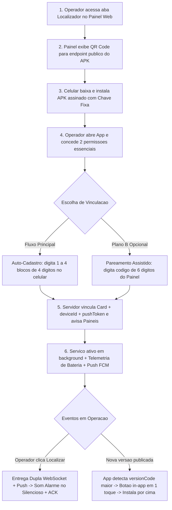
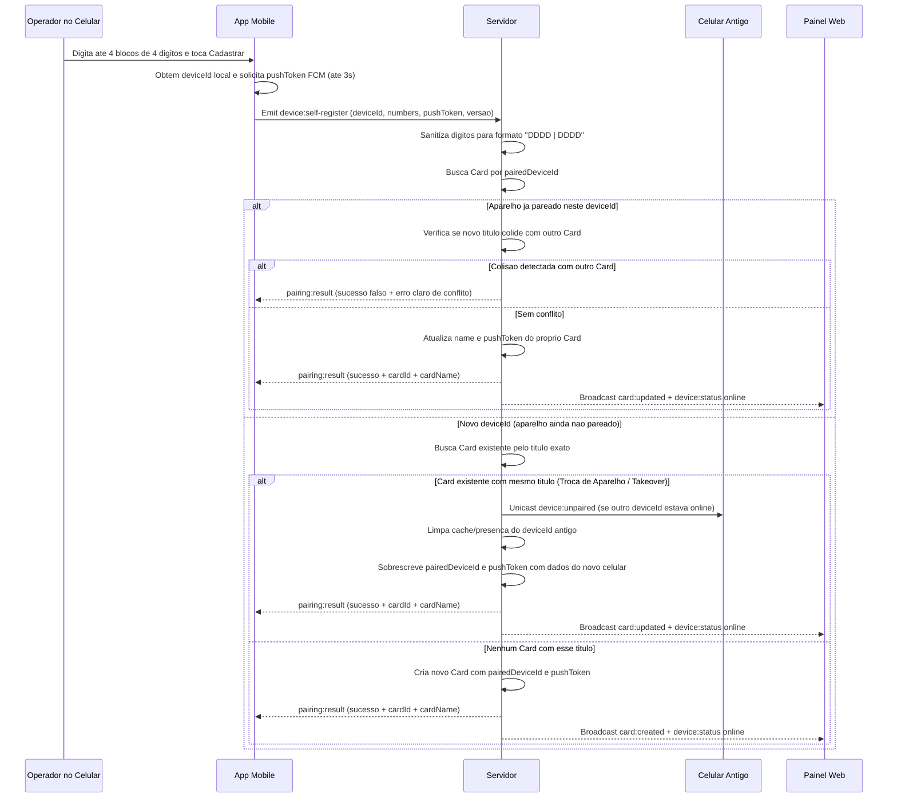
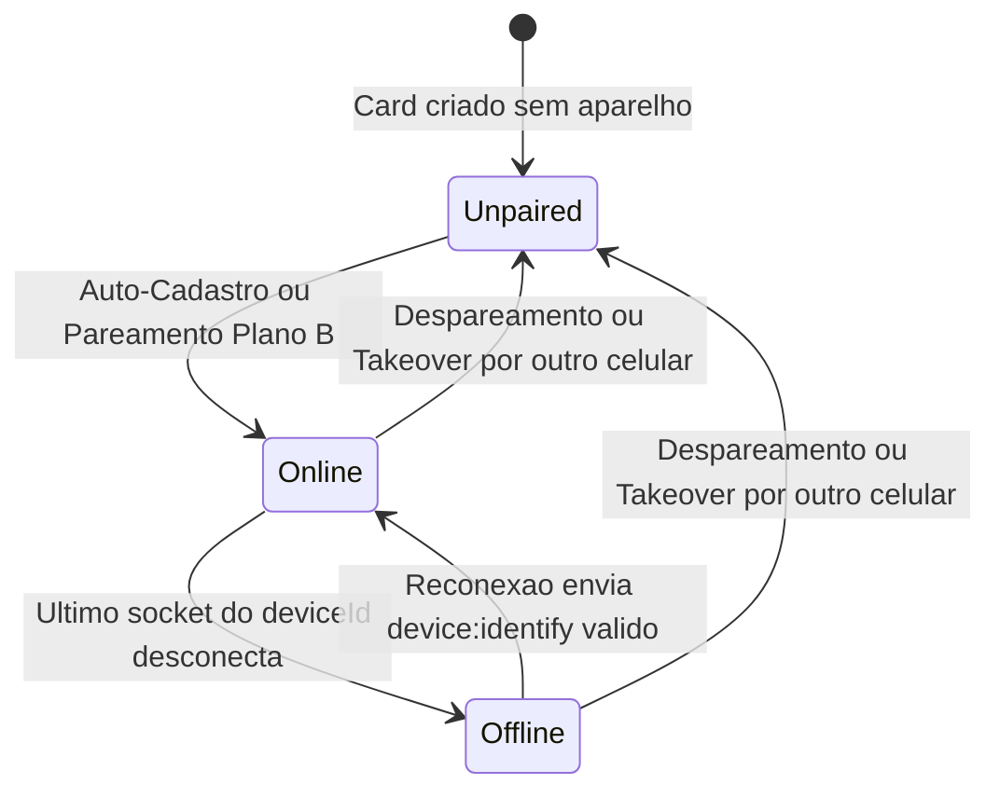
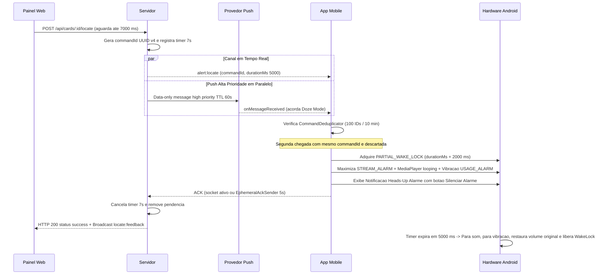
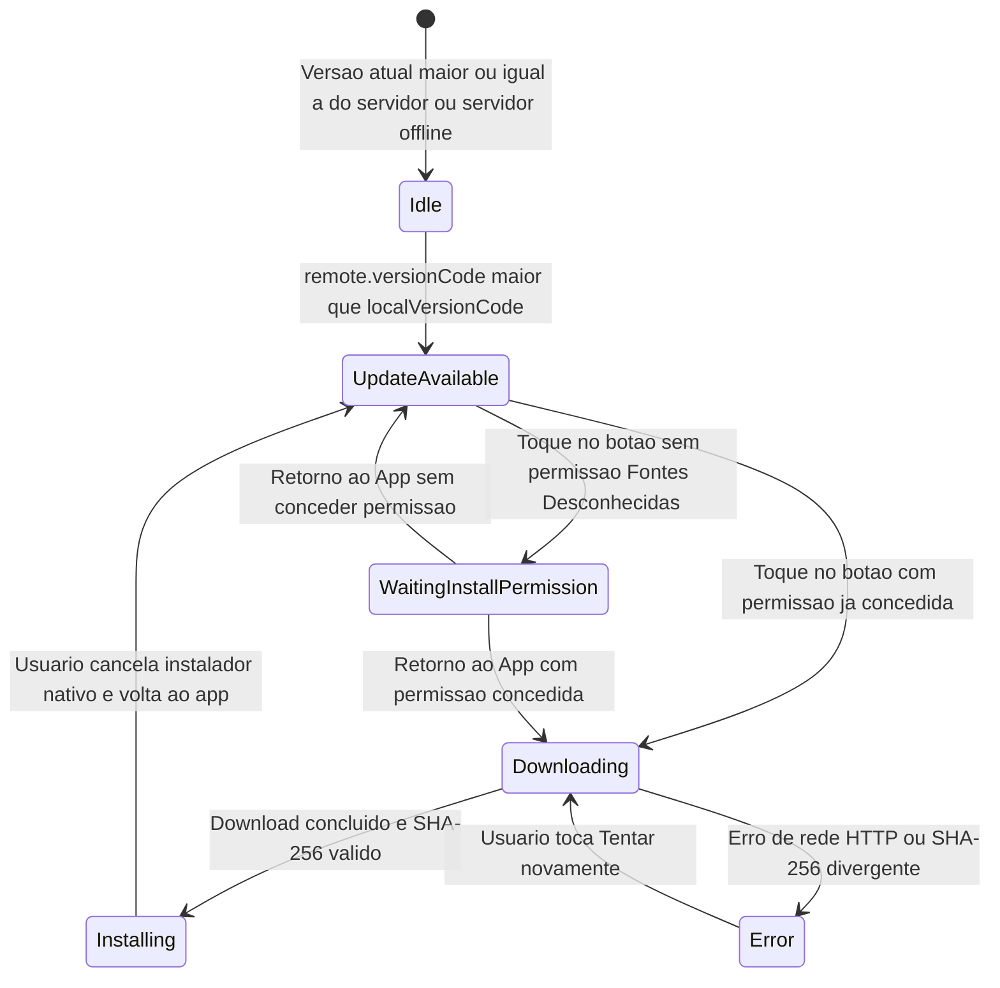
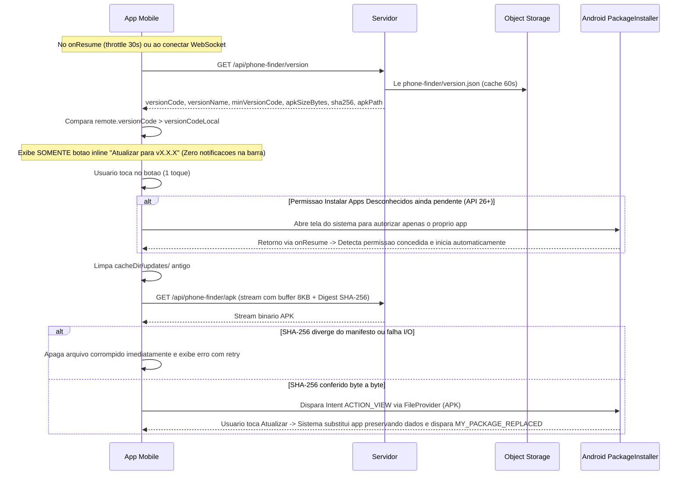

# Localizador Mobile — Especificação Funcional e Arquitetural (SPEC v2.0)

> **Versão:** 2.0  
> **Escopo:** Funcionalidade completa e autossuficiente de localização física de celulares corporativos, desde o painel web e distribuição do aplicativo até o toque no modo silencioso e atualização in-app.  
> **Público-Alvo:** Arquitetos de software e engenheiros responsáveis por replicar esta funcionalidade em outras plataformas, linguagens ou bancos de dados.  
> **Fora de Escopo:** Design visual específico (CSS/cores), layout proprietário do sistema hospedeiro e demais módulos de negócio da plataforma hospedeira.

---

## Evolução Conceitual (v1.0 ➔ v2.0)

Esta especificação substitui e consolida a SPEC v1.0 com todas as melhorias operacionais, correções de fluxo e garantias de segurança validadas em produção:

| Aspecto | SPEC v1.0 (Legado) | SPEC v2.0 (Atual) |
|---|---|---|
| **Fluxo de Cadastro (Onboarding)** | Painel criava Card + gerava código de 6 dígitos para digitar no celular. | **Auto-Cadastro Invertido (Principal):** o celular informa seus blocos numéricos (até 4 blocos de 4 dígitos) e cria/assume seu próprio Card. Código de 6 dígitos mantido como **Plano B opcional**. |
| **Identidade do Dispositivo** | Gerada aleatoriamente no servidor somente durante o código de 6 dígitos. | **Identificador persistente único (`deviceId`)** gerado uma vez na instalação do app e reutilizado tanto no auto-cadastro quanto no Plano B (evitando dessincronização na reconexão). |
| **Comportamento do Alarme Físico** | Tela cheia vermelha (`#FF0000`) sobre bloqueio + som + vibração. | **Alarme Sonoro Puro no Silencioso:** áudio em stream de alarme + vibração intensa + notificação Heads-Up com botão *"Silenciar Alarme"*. Tela vermelha abandonada. |
| **Permissões e Play Protect** | Solicitava `SYSTEM_ALERT_WINDOW` e `USE_FULL_SCREEN_INTENT` (4 permissões). | **Permissões sensíveis removidas (apenas 2 no checklist):** Notificações e Isenção de Otimização de Bateria + assinatura fixa de Release dedicada. |
| **Atualização do App** | Sem checagem ou fluxo de atualização no dispositivo. | **Atualização In-App em 1 Toque:** metadados `version.json` publicados atomicamente, endpoint `/version`, verificação SHA-256, botão inline sem notificação na barra e campo opcional `minVersionCode`. |
| **Sincronização & Escala** | CRUD web sem broadcast completo e mapas apenas locais. | **Sincronização Bidirecional em Tempo Real** para criação/edição/exclusão + seção normativa para **Cluster / Multi-Instância** via barramento compartilhado. |

---

## 1. Contexto e Objetivo

### 1.1 Problema Operacional e Proposta de Valor

Ambientes com múltiplos smartphones físicos compartilhados (bancadas de suporte, atendimento multi-linha, operações de campo, estoques ou laboratórios de QA) sofrem com dois gargalos recorrentes:

1. **Perda de tempo procurando aparelhos:** celulares parecidos ficam em gavetas, carregadores ou mochilas, muitas vezes **no modo silencioso** e com a tela bloqueada.
2. **Etiquetas físicas se degradam:** adesivos na carcaça descolam ou ficam ilegíveis com o uso, dificultando saber qual aparelho contém quais números ou linhas ativas.

O **Localizador Mobile** resolve ambos os problemas como um sistema de *pager* digital corporativo com catálogo automático de identificação:
- Cada aparelho se cadastra informando os códigos que o identificam (por padrão, até 4 blocos de 4 dígitos, como os últimos 4 dígitos de até 4 linhas/contas no formato `"8299 | 1234 | 0845 | 7421"`).
- Operadores no painel web buscam qualquer código numérico, visualizam status online/offline e bateria em tempo real, e acionam **Localizar** (alarme sonoro em volume máximo mesmo no silencioso + vibração) ou **Vibrar** com um clique.
- Quando novas versões do aplicativo móvel são publicadas pelo sistema hospedeiro, o próprio celular detecta a diferença de versão e exibe um botão de atualização em 1 toque.

### 1.2 Conceitos Fundamentais

| Conceito | Definição Conceitual | Regra Chave |
|---|---|---|
| **Card (Cartão)** | Slot lógico persistente no sistema hospedeiro que representa um aparelho físico e seus identificadores. | Desacoplado do hardware: sobrevive a quedas de conexão, reinicializações e trocas de aparelho. |
| **Blocos de Identificação 4x4** | Padrão padrão de nomenclatura do Card: até 4 blocos numéricos de exatamente 4 dígitos separados por `" | "`. | Adaptável pelo sistema hospedeiro, mas mantido como formato canônico no auto-cadastro e busca rápida. |
| **Dispositivo (`deviceId`)** | UUID v4 persistido localmente pelo aplicativo na primeira instalação e preservado entre despareamentos. | Identifica o hardware lógico na rede sem depender de IMEI ou MAC address (protegidos pelo SO). |
| **Auto-Cadastro Invertido** | Fluxo principal onde o operador digita os códigos no próprio celular, que se registra e cria/reivindica o Card no servidor. | Zero necessidade de digitar códigos de pareamento na rotina diária. |
| **Pareamento Plano B (6 dígitos)** | Código efêmero de 6 dígitos (TTL de 5 minutos) gerado no painel para vincular manualmente um aparelho a um Card já criado. | Útil quando um Card foi pré-cadastrado pelo gestor ou em fluxos assistidos. |
| **Comandos Físicos** | Instruções unicast (`locate` ou `vibrate`) com `commandId` único (UUID v4) enviadas via entrega dupla simultânea. | `locate` aciona som em volume máximo de alarme + vibração; `vibrate` aciona apenas vibração intensa. |
| **Presença** | Estado em tempo real da conectividade do Card (`unpaired`, `online`, `offline`). | Botões de acionamento permanecem **sempre habilitados** para cards pareados (`online` ou `offline`) graças ao Push de alta prioridade. |
| **Telemetria de Bateria** | Reporte periódico e orientado a eventos (`level` 0–100 e `isCharging`). | Volátil (memória/cache compartilhado), nunca persistida em disco para evitar sobrecarga de escrita. |
| **Metadados de Versão (`version.json`)** | Manifesto público contendo `versionCode`, `versionName`, tamanho, `sha256` e caminho de download do APK mais recente. | Permite ao app detectar desatualização e validar integridade do binário antes de chamar o instalador do SO. |

### 1.3 Jornada Completa Passo a Passo

O ciclo de vida completo da solução percorre sete etapas contínuas:

1. **Acesso ao Painel Web & Distribuição:** Um operador autenticado abre a aba **Localizador** no sistema hospedeiro e clica em instalar/baixar o aplicativo. O painel exibe um **QR Code** (e link copiável) apontando diretamente para o endpoint público de download do APK.
2. **Instalação Inicial do APK:** A câmera do celular lê o QR Code, baixa o pacote assinado com chave fixa de Release e conclui a instalação padrão no Android (8.0+).
3. **Configuração das Permissões Mínimas (2 itens):** Ao abrir o app, somente duas permissões críticas são necessárias para o funcionamento confiável: **Notificações** (exige confirmação no Android 13+) e **Sem restrição de bateria** (evita suspensão em bancada). Nenhuma permissão invasiva de sobreposição de tela é pedida.
4. **Cadastro Concluído (Auto-Cadastro):** Na tela inicial, o operador preenche de 1 a 4 blocos de 4 dígitos referentes aos números daquele celular (ex.: `8299`, `1234`), confere/ajusta a URL do servidor se necessário, e toca em **Cadastrar Aparelho**. O app obtém o token de push, envia o evento de auto-cadastro, o servidor persiste o Card, devolve a confirmação e propaga em tempo real para todos os painéis abertos.
5. **Operação Contínua e Telemetria:** O celular inicia o serviço em primeiro plano (`remoteMessaging`), mantém a conexão bidirecional em tempo real, reporta versão instalada + bateria (a cada 10 minutos ou variação significativa) e garante escuta de push data-only mesmo se entrar em Doze Mode profundo.
6. **Acionamento e Toque no Modo Silencioso:** No painel web, o operador filtra por status ou digita parte dos números na busca, e clica em **Localizar** (ou **Vibrar**). O servidor despacha o comando simultaneamente por WebSocket (se online) e Push de alta prioridade. O celular maximiza temporariamente o stream de alarme do sistema, toca e vibra mesmo no modo silencioso, exibe notificação de alarme com botão *"Silenciar Alarme"*, restaura o volume original ao fim do timer e envia a confirmação (ACK) para o painel exibir feedback verde ao operador.
7. **Atualização In-App em 1 Toque:** Quando uma nova versão do APK e seu `version.json` são publicados no storage, o app consulta `/api/phone-finder/version` em segundo plano ao retomar a tela ou conectar. Se `versionCode` remoto for maior, exibe um botão destacado **"Atualizar para vX.X.X"** direto na interface (sem poluir a barra de notificações). Com 1 toque, o app solicita permissão única de fontes desconhecidas (se ainda não concedida), baixa o APK com barra de progresso, valida o hash SHA-256 e abre imediatamente o instalador nativo do Android mantendo todos os dados cadastrados.



---

## 2. Contratos de Entrada e Saída (I/O)

### 2.1 Modelo de Dados Persistente (`Card`)

A plataforma hospedeira deve persistir a entidade `Card` em banco transacional (relacional ou documental) com as seguintes propriedades:

| Campo | Tipo Lógico | Obrigatoriedade / Índice | Descrição e Regras |
|---|---|---|---|
| `id` | UUID v4 (string) | Chave Primária | Identificador imutável gerado pelo servidor na criação do Card. |
| `name` | Texto (máx. 120 chars recomendado) | Obrigatório | Nome legível exibido no painel e no celular. No padrão 4x4 assume `"DDDD \| DDDD \| DDDD \| DDDD"`. Deve garantir **unicidade lógica** para nomes normalizados na edição e criação manual. |
| `description` | Texto longo (opcional, máx. 300 chars UI) | Opcional (nulo se vazio) | Observação operacional livre (ex.: modelo do aparelho, bancada, equipe). |
| `pairedDeviceId` | UUID v4 (string) | Opcional, **Índice Único** | Referência ao `deviceId` atualmente vinculado ao Card. Nulo indica Card não pareado (`unpaired`). A unicidade no banco impede que um mesmo dispositivo físico fique vinculado simultaneamente a dois Cards. |
| `pushToken` | Texto longo | Opcional (**Segredo Interno**) | Token do serviço de push notification do dispositivo vinculado. **Nunca deve ser retornado nas APIs de leitura ou broadcasts ao painel.** |
| `createdAt` | Timestamp UTC (ISO 8601) | Automático | Data/hora de criação. Listagens ordenam por `createdAt` decrescente por padrão. |
| `updatedAt` | Timestamp UTC (ISO 8601) | Automático | Data/hora da última modificação estrutural. |

#### Objeto Enriquecido de Saída para o Painel (`CardEnriched`)
Toda resposta HTTP ou evento em tempo real direcionado ao painel web omite `pushToken` e anexa o estado calculado em tempo real:
- Campos persistidos: `id`, `name`, `description`, `pairedDeviceId`, `createdAt`, `updatedAt`.
- Campos derivados/voláteis:
  - `status`: `"unpaired"` (se `pairedDeviceId` for nulo), `"online"` (se possuir ao menos uma conexão em tempo real ativa) ou `"offline"` (pareado sem conexão ativa).
  - `hasPushToken`: booleano indicando se `pushToken` não é nulo nem vazio.
  - `battery`: objeto `{ level: inteiro 0..100, isCharging: booleano, updatedAt: ISO 8601 }` ou `null`.
  - `appVersionCode`: inteiro positivo ou `null`.
  - `appVersionName`: string (ex.: `"1.2.0"`) ou `null`.

### 2.2 Contratos HTTP / REST

#### Política Recomendada de Controle de Acesso
A autenticação é responsabilidade do sistema hospedeiro (JWT em cabeçalho Bearer, cookie de sessão HttpOnly, ou mecanismo equivalente). Para integração em novas plataformas, recomenda-se segregar em dois perfis lógicos além das rotas públicas de binário:

| Perfil | Permissões Recomendadas | Justificativa |
|---|---|---|
| **Operador** | Listar cards, consultar status, acionar **Localizar** e **Vibrar**. | Permite à equipe diária encontrar aparelhos sem risco de alterar cadastros ou desvincular dispositivos por acidente. |
| **Gestor / Admin** | Tudo do Operador + criar/editar/excluir Cards, gerar código de pareamento e desvincular aparelhos. | Protege a integridade do inventário de slots e configurações de identificação. |
| **Público (Sem Auth)** | Exclusivamente download do APK e leitura de `version.json`. | Celulares novos lendo o QR Code e apps antes do login não possuem sessão web do painel. |

#### Endpoints de Gerenciamento e Acionamento (Autenticados)

| Método | Caminho | Perfil Sugerido | Entrada (JSON) | Saída & Códigos HTTP | Comportamento Normativo |
|---|---|---|---|---|---|
| `GET` | `/api/cards` | Operador | — | `200`: `CardEnriched[]`; `500`: `{ error }` | Lista todos os cards ordenados por `createdAt DESC` com presença, bateria e versão anexadas. |
| `GET` | `/api/cards/:id` | Operador | Path `id` | `200`: `CardEnriched`; `404`: `{ error }` | Detalhe atualizado de um único Card. |
| `POST` | `/api/cards` | Gestor | `{ name, description? }` | `201`: `CardEnriched`; `400`: validação; `409`: nome duplicado | Remove espaços das pontas de `name`; converte `description` só com espaços em `null`. Emite broadcast `card:created` para o painel. |
| `PUT` | `/api/cards/:id` | Gestor | `{ name?, description? }` | `200`: `CardEnriched`; `400`: validação; `404`; `409`: conflito | Valida unicidade se `name` mudou. Emite `card:updated` em broadcast ao painel e, se pareado e conectado, notifica o dispositivo alvo para atualizar o nome exibido na tela do celular. |
| `DELETE` | `/api/cards/:id` | Gestor | Path `id` | `200`: `{ success: true }`; `404` | Invalida código de pareamento ativo, exclui do banco, emite `device:unpaired` para o dispositivo conectado, limpa caches voláteis e emite broadcast `card:deleted` + `device:status` (`unpaired`) ao painel. |
| `POST` | `/api/cards/:id/pairing-code` | Gestor | Path `id` | `200`: `{ cardId, code, expiresAt }`; `404` | Gera código numérico aleatório de 6 dígitos com TTL de 5 minutos, invalidando código anterior do mesmo Card. |
| `POST` | `/api/cards/:id/unpair` | Gestor | Path `id` | `200`: `{ success: true }`; `404` | Zera `pairedDeviceId` e `pushToken` no banco, invalida código ativo, envia `device:unpaired` ao celular, limpa presença/caches e emite `device:status` (`unpaired`). |
| `POST` | `/api/cards/:id/locate` | Operador | Path `id` | `200` (`status: "success"`), `400` (não pareado), `404`, `408` (`status: "timeout"`), `409` (comando em curso), `502` (falha na execução), `503` (offline sem push) | **Operação síncrona com espera máxima de 7000 ms** pelo ACK do aparelho. Sempre propaga `locate:feedback` para todos os painéis. |
| `POST` | `/api/cards/:id/vibrate` | Operador | Path `id` | Mesma matriz de status de `locate` | Duração padrão `3000 ms`. Propaga `vibrate:feedback` para todos os painéis. |

> **Nota sobre Retorno dos Comandos (`CommandFeedback`):** Tanto as respostas HTTP quanto os eventos `locate:feedback` / `vibrate:feedback` seguem o formato `{ cardId: string, commandId: string, status: "success" | "timeout" | "error", message: string }`.

#### Endpoints Públicos de Distribuição e Atualização

| Método | Caminho | Entrada / Query | Cabeçalhos Obrigatórios | Respostas |
|---|---|---|---|---|
| `GET` | `/api/phone-finder/apk` | — | `Content-Type: application/vnd.android.package-archive`, `Content-Disposition: attachment; filename="<nome-do-apk>.apk"`, `Cache-Control: no-cache, no-store, must-revalidate`, `Content-Length` | `200`: stream binário direto do Object Storage; `404`: `{ error }` se APK não publicado; `500`: erro de streaming. |
| `GET` | `/api/phone-finder/version` | Query opcional `?fresh=1` (ignora cache de 60s) | `Cache-Control: no-cache, no-store, must-revalidate`, `Content-Type: application/json` | `200`: manifesto de versão JSON; `404`: `{ error }` se `version.json` ausente ou inválido. |

##### Contrato Estrutural de `version.json` (Armazenado e Retornado pela API)

```json
{
  "versionCode": 5,
  "versionName": "1.2.0",
  "minVersionCode": 4,
  "apkSizeBytes": 1914816,
  "sha256": "37691335d9c0aa3e8f62eb6e3e7b0f9d9ca671d62a3fdbed33477705b825e9da",
  "publishedAt": "2026-11-21T15:55:00.000Z",
  "apkPath": "/api/phone-finder/apk"
}
```

- `versionCode`: inteiro estritamente positivo (`>= 1`). Critério único de comparação numérica no app (`remote.versionCode > installedVersionCode`).
- `versionName`: string legível não vazia exibida no botão do app (ex.: `"Atualizar para v1.2.0"`).
- `minVersionCode` *(opcional)*: inteiro positivo. Caso fornecido pela plataforma hospedeira e `installedVersionCode < minVersionCode`, indica que a atualização é **crítica/obrigatória** (permitindo à plataforma exibir aviso bloqueante até concluir a instalação). Se omitido ou `<= installedVersionCode`, a atualização é opcional via botão inline.
- `apkSizeBytes`: tamanho em bytes (usado como fallback de progresso se o proxy omitir `Content-Length`).
- `sha256`: hash hexadecimal de 64 caracteres do APK binário para verificação estrita de integridade pós-download.
- `apkPath`: caminho relativo (padrão `"/api/phone-finder/apk"`) concatenado à URL base configurada no app (permitindo também URL absoluta assinada/CDN se outra plataforma desejar).

### 2.3 Contratos de Canal Bidirecional em Tempo Real (WebSocket)

A camada em tempo real divide a comunicação em dois **namespaces lógicos isolados**:

1. **Namespace `/panel` (Operadores Web — Autenticado):**
   - Extração do token de sessão no handshake em ordem de prioridade: payload de autenticação (`auth.token`) → cabeçalho `Authorization: Bearer <token>` → cookie `token`.
   - Valida sessão JWT e verifica se usuário segue ativo no banco. Falha rejeita o handshake com erro de não autorizado.
2. **Namespace `/device` (Dispositivos Móveis — Baseado em Identidade de Instalação):**
   - Não utiliza login de usuário web. A identidade é estabelecida no evento `device:self-register`, `pairing:submit` ou `device:identify`.
   - Proteção anti-força-bruta no `pairing:submit` extraindo o IP real do cliente (primeiro IP de `x-forwarded-for`, com fallback para IP da conexão ou ID de socket).

#### Eventos no Namespace `/panel`

| Direção | Evento | Payload | Modo de Entrega |
|---|---|---|---|
| Painel → Servidor | `pairing:generate` | `{ cardId }` + callback opcional `{ ok, data \| error }` | Unicast para solicitante |
| Painel → Servidor | `device:unpair` | `{ cardId }` + callback opcional `{ ok, error? }` | Confirmação ao solicitante + efeitos |
| Painel → Servidor | `locate:trigger` | `{ cardId }` | Assíncrono (resposta via broadcast) |
| Painel → Servidor | `vibrate:trigger` | `{ cardId }` | Assíncrono (resposta via broadcast) |
| Servidor → Painel | `pairing:generated` | `{ cardId, code, expiresAt }` | Unicast ao socket solicitante |
| Servidor → Painel | `card:created` | `CardEnriched` | Broadcast para todo `/panel` |
| Servidor → Painel | `card:updated` | `CardEnriched` | Broadcast para todo `/panel` |
| Servidor → Painel | `card:deleted` | `{ cardId }` | Broadcast para todo `/panel` |
| Servidor → Painel | `device:status` | `{ cardId, status, deviceId?, hasPushToken?, appVersionCode?, appVersionName? }` | Broadcast para todo `/panel` |
| Servidor → Painel | `card:battery` | `{ cardId, deviceId, level, isCharging, updatedAt }` | Broadcast para todo `/panel` |
| Servidor → Painel | `locate:feedback` | `{ cardId, commandId, status, message }` | Broadcast para todo `/panel` |
| Servidor → Painel | `vibrate:feedback` | `{ cardId, commandId, status, message }` | Broadcast para todo `/panel` |

#### Eventos no Namespace `/device`

| Direção | Evento | Payload | Regra Crítica |
|---|---|---|---|
| App → Servidor | `device:self-register` | `{ deviceId, numbers[], pushToken?, appVersionCode?, appVersionName? }` | Fluxo principal: `numbers` é array de strings; servidor sanitiza para 4x4. |
| App → Servidor | `pairing:submit` | `{ code, deviceId?, pushToken?, appVersionCode?, appVersionName? }` | Plano B: código 6 dígitos. **O `deviceId` persistente do aparelho deve ser enviado/reaproveitado** para evitar divergência na reconexão. |
| App → Servidor | `device:identify` | `{ deviceId, pushToken?, appVersionCode?, appVersionName? }` | Emitido em **toda** conexão/reconexão e sempre que o `pushToken` rotacionar. |
| App → Servidor | `device:battery` | `{ deviceId, level, isCharging? }` | Rejeitado silenciosamente se o socket ainda não estiver autenticado para o mesmo `deviceId`. |
| App → Servidor | `alert:ack` / `vibrate:ack` | `{ commandId, status: "ok" \| "error", timestamp }` | **`timestamp` aqui é numérico (Unix epoch ms)**; todos os demais timestamps do protocolo usam string ISO 8601. |
| Servidor → App | `pairing:result` | Sucesso: `{ success: true, deviceId, cardId, cardName }` / Erro: `{ success: false, error }` | Unicast para o socket solicitante. |
| Servidor → App | `card:updated` | `{ cardId, cardName }` | Unicast para o dispositivo alvo caso um gestor edite o nome pelo painel web. |
| Servidor → App | `alert:locate` / `alert:vibrate` | `{ commandId, action, durationMs, timestamp, cardName }` | **Unicast estrito** para os sockets daquele `deviceId` (nunca broadcast). |
| Servidor → App | `device:unpaired` | `{ message }` | Unicast para todos os sockets ativos do `deviceId` afetado. |

### 2.4 Contrato de Push Notification de Alta Prioridade (Data-Only)

Para despertar dispositivos em repouso profundo (*Doze Mode*), o servidor utiliza o serviço de Push (referência: Firebase Cloud Messaging API HTTP v1 / Admin SDK) exclusivamente com **mensagens de dados (sem bloco visual `notification`)**:

```json
{
  "token": "<pushToken do Card>",
  "data": {
    "commandId": "<UUID v4>",
    "action": "locate | vibrate",
    "durationMs": "5000",
    "timestamp": "2026-11-21T19:00:00.000Z",
    "cardName": "8299 | 1234"
  },
  "android": {
    "priority": "high",
    "ttl": 60000
  }
}
```

- **Regra obrigatória de tipagem:** Todos os valores dentro de `data` devem ser convertidos em **strings** (incluindo `durationMs`), pois provedores de push como o FCM rejeitam números/booleanos em payloads de dados.
- **Por que nunca enviar bloco `notification`:** Mensagens do tipo *notification* são interceptadas pelo SO em Doze Mode e apenas empilhadas silenciosamente na bandeja sem executar o código do aplicativo. Mensagens *data-only* com `priority: "high"` atravessam o Doze Mode e invocam diretamente o receptor do app (`onMessageReceived`).

### 2.5 Contrato de Publicação Atômica de Release

O pipeline de build e publicação de uma nova versão do aplicativo deve obedecer à seguinte ordem estrita:
1. Ler automaticamente `versionCode` (inteiro) e `versionName` (string) do arquivo de build da aplicação móvel (com possibilidade de sobrescrita explícita por parâmetros de CLI).
2. Calcular o tamanho exato em bytes (`apkSizeBytes`) e o hash `SHA-256` em hexadecimal minúsculo do arquivo `.apk` assinado de Release.
3. **Ordem Atômica Obrigatória:**
   - **Passo A:** Fazer upload completo do binário `.apk` para o Object Storage.
   - **Passo B:** Somente após confirmação de sucesso do Passo A, gravar o `version.json` atualizado no Object Storage.
4. Isso garante que nenhum celular consultando `/api/phone-finder/version` tente baixar uma versão cujo arquivo binário ainda não terminou de subir ou pertence à versão anterior (o que causaria falha na verificação SHA-256).

---

## 3. Regras de Negócio e Fluxo Lógico

### 3.1 Distribuição por QR Code e Instalação Inicial

1. O painel web gera dinamicamente o QR Code apontando para a URL pública completa do endpoint `/api/phone-finder/apk` derivada da origem ativa do servidor web/API (exibindo alerta visual ao operador caso esteja acessando via `localhost` ou `127.0.0.1`, pois a câmera de um celular externo não alcançará endereços de loopback).
2. Após baixar e instalar o APK no celular, o app armazena localmente um `installationId` (UUID v4 imutável) em preferências privadas síncronas (`SharedPreferences` com commit síncrono, nunca assíncrono). Esse identificador atua como `deviceId` canônico do aparelho durante toda a vida útil da instalação.

### 3.2 Auto-Cadastro Invertido (Fluxo Principal), Edição e Política de Colisão



#### Regras Estritas de Formatação e Colisão
1. **Sanitização dos Blocos (`formatCardTitleFromNumbers`):**
   - Cada campo enviado no array `numbers` tem todos os caracteres não numéricos removidos.
   - Somente blocos com **exatamente 4 dígitos** são mantidos.
   - Máximo de **4 blocos válidos**. Se nenhum bloco válido restar, o servidor rejeita com erro claro (`"Nenhum número de 4 dígitos informado."`).
   - Os blocos válidos são concatenados na ordem informada com `" | "` (ex.: `"8299 | 1234 | 0845 | 7421"`).
2. **Takeover Seguro em Cadastro Novo:**
   - Quando um dispositivo **ainda não pareado** se registra com os mesmos números de um Card existente (ex.: o chip ou WhatsApp migrou para outro aparelho), o sistema assume automaticamente aquele Card (takeover): desvincula o `deviceId` antigo emitindo `device:unpaired`, limpa os caches do hardware antigo e **sobrescreve explicitamente `pushToken` com o novo valor (ou `null` caso o novo aparelho não tenha FCM)** — evitando que alarmes sejam disparados no aparelho antigo por um token residual.
3. **Proibição de Colisão na Edição:**
   - Quando um aparelho **já pareado** edita seus números (pelo celular) ou quando um gestor renomeia um Card (pelo painel web `PUT /api/cards/:id`) para um título idêntico ao de **outro Card já existente**, o servidor deve **rejeitar a edição com erro explícito de conflito** (HTTP `409` no painel / `pairing:result` de erro no celular). Nunca mesclar dois Cards distintos nem permitir duplicatas acidentais na edição.
   - *Observação de Sincronização Web ↔ Celular:* quando editado pelo painel web (Plano B), o servidor propaga `card:updated` para todo o `/panel` e também envia `card:updated` ao socket do dispositivo pareado para que a tela do celular reflita imediatamente o novo título sem precisar reiniciar.

### 3.3 Pareamento por Código de 6 Dígitos (Plano B Opcional)

Mantido na UI secundária do aplicativo (*"Já tenho um código de 6 dígitos"*):
1. O operador no painel solicita um código para um Card específico (`POST /api/cards/:id/pairing-code` ou `pairing:generate`).
2. O servidor gera 6 dígitos via CSPRNG no intervalo `100000..999999` (com até 20 tentativas em caso de colisão rara), com **TTL de 5 minutos (`300.000 ms`)**, armazenado **apenas em memória** (nunca persistido em disco/banco).
3. Solicitar um novo código para o mesmo Card invalida imediatamente qualquer código ativo anterior daquele Card.
4. Um coletor periódico em background varre e remove códigos expirados a cada **30 segundos (`30.000 ms`)**.
5. Quando o celular envia `pairing:submit`:
   - Aplica **rate limit** por endereço IP do cliente: máximo de **10 tentativas inválidas em uma janela deslizante de 60 segundos (`60.000 ms`)**. Excedido o limite, bloqueia temporariamente novas submissões com erro explícito.
   - Valida em ordem: formato (`/^\d{6}$/`) → existência em memória → expiração → existência do Card no banco.
   - **Uso único atômico:** remove o código do mapa em memória **antes** de aguardar gravação assíncrona no banco (prevenindo corrida TOCTOU).
   - **Consistência obrigatória do `deviceId` (evolução v2.0):** ao receber `pairing:submit`, o servidor adota o `deviceId` persistente enviado pelo aparelho (validado como UUID válido), ou gera um novo somente se omitido — e o aplicativo salva o `deviceId` retornado como seu identificador definitivo, garantindo que reconexões futuras via `device:identify` correspondam exatamente ao `pairedDeviceId` salvo no Card.

### 3.4 Máquina de Estados de Presença, Cache Zero-DB e Telemetria de Bateria



1. **Múltiplos Sockets por Dispositivo:** O servidor mantém uma relação `1:N` (`deviceId -> Set<socketId>`) em memória. Em trocas rápidas de rede (Wi-Fi ↔ 4G), o novo socket pode conectar milissegundos antes de o antigo cair por timeout; o aparelho só transiciona para `offline` quando o **último** socket daquele `deviceId` é fechado (`wentOffline = true`).
2. **Verificação pós-await contra Socket Fantasma:** Após qualquer operação assíncrona de banco em `device:self-register`, `pairing:submit` ou `device:identify`, o servidor verifica se o socket ainda está conectado antes de registrá-lo na presença, impedindo dispositivos fantasmas presos em `online`.
3. **Cache `deviceId -> cardId` Zero-Query:** Toda vez que um dispositivo se identifica ou cadastra, o servidor grava em memória a associação direta `deviceId -> cardId`. Quando o evento frequente `device:battery` chega, o servidor resolve o `cardId` diretamente desse cache em RAM sem consultar o banco de dados (zerando carga de banco em frotas grandes), fazendo query no banco apenas em *cache miss*.
4. **Política Inteligente de Envio de Bateria no App:**
   - Captura via receptor de sistema (`ACTION_BATTERY_CHANGED`) e um ciclo periódico em segundo plano de **10 minutos (`600.000 ms`)**.
   - Para economizar bateria e banda, um reporte só é transmitido ao servidor se: for o primeiro envio da sessão, **OU** o estado de carregamento (`isCharging`) mudou, **OU** passaram pelo menos **10 minutos** desde o último envio (*heartbeat*), **OU** o nível variou `>= 2%` e já se passou ao menos **1 minuto (`60.000 ms`)** desde o último envio.
   - O servidor normaliza o valor entre `0..100` (arredondado), rejeita números inválidos (`NaN`/`Infinity`) e descarta silenciosamente eventos de bateria vindos de um socket ainda não autenticado com o mesmo `deviceId`.

### 3.5 Despacho Híbrido Duplo, Motor de Alarme no Silencioso e Ciclo de ACK



#### Regras Críticas de Execução no Dispositivo
1. **Concorrência por Card:** O servidor permite no máximo **1 comando em andamento por Card** (`inFlightByCard`). Tentativas simultâneas retornam HTTP `409 Conflict`.
2. **Preempção Local e Timer Inviolável:** Caso o usuário dispare um novo comando ou teste local (`3000 ms`) enquanto um alerta anterior ainda toca no aparelho, um contador monotônico (`activeRunId`) cancela imediatamente o agendamento anterior, limpa áudio/vibração anteriores e inicia o novo alerta sem condição de corrida no desligamento.
3. **Garantia do Som no Modo Silencioso / DND:**
   - O reprodutor de áudio utiliza exclusivamente atributos `USAGE_ALARM` / `CONTENT_TYPE_SONIFICATION` no stream `STREAM_ALARM` (independente do volume de mídia ou toque de chamadas).
   - Antes de iniciar o áudio, salva o volume atual de `STREAM_ALARM` e eleva ao máximo dentro de captura segura de exceção de segurança (caso uma política DND estrita do fabricante bloqueie alteração programática de volume, o erro é ignorado e som/vibração continuam). Ao terminar ou silenciar manualmente, restaura o volume anterior.
   - Cadeia automática de fallback para URI do toque: Alarme Padrão → Toque de Chamada Padrão → Som de Notificação Padrão.
   - `durationMs` recebido na rede passa por *clamp* defensivo estrito entre **`500 ms` e `30.000 ms`** no app para impedir toques infinitos causados por payloads corrompidos.
4. **Notificação Heads-Up sem Tela Vermelha:**
   - No modo `locate`, em vez de sobrepor uma Activity em tela vermelha, o app exibe uma notificação persistente no canal de alertas de alta prioridade (`IMPORTANCE_HIGH`, visibilidade pública na tela de bloqueio, `setBypassDnd(true)`, categoria alarme, áudio silencioso no canal pois o `MediaPlayer` já controla o som) com ação direta **"Silenciar Alarme"** que interrompe o alerta imediatamente ao toque do operador.
   - No modo `vibrate` vindo via Push em background, exibe notificação transitória discreta para feedback do canal e executa apenas vibração com waveform dedicada.
5. **ACK Efêmero (Quando Acordado via Push Offline):**
   - Se o socket persistente principal estiver desconectado no momento em que o Push acorda o app (cenário clássico de Doze Mode), `onMessageReceived` **não pode** tentar iniciar o `ForegroundService` (o Android 12–15 lança exceção de segurança em background). Em vez disso, executa o hardware diretamente e dispara uma conexão WebSocket efêmera descartável (`EphemeralAckSender`: sem reconexão, timeout `5000 ms`, janela de *flush* `300 ms`) apenas para entregar o `alert:ack` ou `vibrate:ack` e desconectar.
6. **Segurança e Limpeza de Token Inválido:**
   - Ao receber ACK via socket identificado, o servidor rejeita se o `deviceId` do socket divergir do `deviceId` esperado pelo comando.
   - Se o provedor Push retornar erro explícito de token inválido/não registrado, o servidor relê o Card antes de gravar (evitando apagar um token recém-atualizado por outro evento concorrente), limpa `pushToken = null`, propaga `hasPushToken: false` para `/panel` e, caso não haja socket online ativo, falha imediatamente em `503` sem desperdiçar os 7 segundos do timeout.

### 3.6 Atualização In-App em 1 Toque (Sem Notificação na Barra)





#### Regras Normativas da Atualização
1. **Silêncio Visual na Barra:** É estritamente proibido emitir qualquer notificação na barra de status do Android alertando sobre nova versão disponível. O aviso existe apenas na interface do app através de botão dedicado na tela principal pareada e também na tela inicial (para permitir atualização antes mesmo do pareamento).
2. **Checagem Discreta:** Disparada na retomada da tela (`onResume`, limitada por throttle de **30 segundos**) e ao estabilizar a conexão WebSocket. Falhas de rede ou HTTP 404 falham silenciosamente mantendo ou revertendo o estado para `Idle` (nunca exibem alertas de erro durante checagens automáticas).
3. **Preservação de Dados na Troca de Versão:** Porque o app usa chave fixa de assinatura e escuta o broadcast de sistema `MY_PACKAGE_REPLACED`, ao confirmar **"Atualizar"** no instalador do Android:
   - Todos os dados em `SharedPreferences` (`installationId`, `cardId`, `cardName`, `serverUrl`, `pushToken`) são **100% preservados**.
   - O `BootReceiver` reinicia automaticamente o serviço em primeiro plano logo após a atualização concluir, mantendo o celular monitorável sem sequer abrir o app novamente.
4. **Higiene de Cache:** Arquivos temporários de atualização (`cacheDir/updates/*.apk`) são removidos tanto na inicialização do aplicativo quanto antes de cada novo download.

### 3.7 Estratégia Anti-Play Protect e Mitigação de "App Possivelmente Nocivo"

Sistemas Android executam heurísticas locais e em nuvem (Google Play Protect) quando um usuário instala um APK fora da Play Store (*sideloading*). Diferente de sistemas desktop como Windows/macOS, **não existe certificado pago ou gratuito emitido por terceiros que torne um APK externo automaticamente confiável pelo Play Protect**. O mecanismo avalia três vetores principais: origem do binário, reputação criptográfica contínua da chave assinante e perfil de permissões sensíveis declaradas no manifesto.

Para minimizar ao máximo falsos positivos e atritos operacionais de forma **100% gratuita**, esta arquitetura aplica quatro pilares obrigatórios:

1. **Assinatura Criptográfica Fixa de Release Dedicada (Nunca Debug):**
   - Proibido publicar ou distribuir APKs assinados com a keystore padrão de desenvolvimento (`CN=Android Debug`, gerada localmente por máquina e sinalizada como suspeita por heurísticas anti-malware).
   - O projeto provisiona uma keystore própria fixa (`PKCS12`, algoritmo RSA 2048 bits, validade longa — ex.: 10.000 dias — com `CN` corporativo próprio) armazenada em arquivo local ignorado pelo controle de versão e injetada em tempo de build. Além de reduzir desconfiança heurística, mantém a mesma impressão digital SHA-256 em todas as compilações, construindo reputação contínua e permitindo atualizações in-place sem conflito de assinatura (`INSTALL_FAILED_UPDATE_INCOMPATIBLE`).
2. **Minimização Agressiva de Permissões Sensíveis (Princípio do Menor Privilégio):**
   - Permissões de sobreposição global de janelas (`SYSTEM_ALERT_WINDOW`) e tomada de tela cheia sobre bloqueio (`USE_FULL_SCREEN_INTENT`) são as principais responsáveis por classificar apps fora da loja como potenciais *adware*, *ransomware* ou *screen lockers*.
   - Com a adoção do **Alarme Sonoro Puro**, ambas foram **removidas do manifesto**, reduzindo drasticamente a superfície de risco e simplificando a configuração manual do operador para apenas 2 permissões benignas (Notificações e Otimização de Bateria).
   - A permissão `REQUEST_INSTALL_PACKAGES` é declarada exclusivamente para suportar a atualização em 1 toque via `FileProvider`, exigindo aprovação isolada pelo usuário apenas na primeira atualização do aparelho.
3. **Configurações de Segurança do Manifesto & Build:**
   - `allowBackup = false` impede que o Android restaure preferências obsoletas de pareamento ao reinstalar em novos aparelhos.
   - Ofuscação e redução de código R8/ProGuard habilitadas em Release mantendo explicitamente apenas os pacotes de rede, JSON, mensagens push e componentes Android registrados no manifesto.
4. **Caminhos Complementares caso o Fabricante/Google Bloqueie em Escala:**
   - **Apelação Gratuita ao Play Protect (Play Protect Appeals):** caso um lote novo sofra falso positivo temporário antes de ganhar reputação, o administrador pode submeter o APK e a justificativa de uso corporativo interno pelo formulário oficial gratuito do Google.
   - **Distribuição Privada sem Sideloading (Opcional fora da SPEC gratuita):** caso a organização possua conta Google Play Console (taxa única administrativa) e publique em canal de *Teste Interno* ou *Managed Google Play* privado, ou utilize MDM em modo *Device Owner*, todos os avisos do Play Protect desaparecem e a atualização passa a ocorrer silenciosamente.

---

## 4. Dependências, Estados Implícitos, Constantes Mágicas e Efeitos Colaterais

### 4.1 Catálogo Completo de Constantes Mágicas, Timeouts e Limites

Todos os parâmetros abaixo foram extraídos da implementação de referência e devem ser replicados ou configurados explicitamente em qualquer nova plataforma:

| Camada | Parâmetro / Constante | Valor Padrão | Finalidade / Impacto se Alterado |
|---|---|---|---|
| **Backend — Comandos** | `LOCATE_DURATION_MS` | `5000 ms` | Duração padrão do alarme sonoro + vibração de localização. |
| **Backend — Comandos** | `VIBRATE_DURATION_MS` | `3000 ms` | Duração padrão do comando silencioso de vibração. |
| **Backend — Comandos** | `DEFAULT_ACK_TIMEOUT_MS` | `7000 ms` | Soma de ~1s entrega push + 5s alerta + 1s margem ACK. Reduzir gera falsos timeouts em Doze Mode. |
| **Backend — Push FCM** | `ttl` / `priority` | `60000 ms` / `"high"` | Expiração máxima de push na fila do Google; após 60s um comando obsoleto não deve acordar o celular. |
| **Backend — Socket.IO** | `pingTimeout` / `pingInterval` | `120000 ms` / `45000 ms` | Tolerância elevada evita falsos offline durante micro-suspensões de rede móveis sem drenar bateria. |
| **Backend — Pareamento** | Formato e Faixa do Código | `/^\d{6}$/` (`100000..999999`) | 900.000 combinações; até `20` retentativas contra colisão em memória. |
| **Backend — Pareamento** | `PAIRING_TTL_MS` / Varredura | `300000 ms` (5 min) / `30000 ms` | Janela de validade do código Plano B e frequência do garbage collector em RAM. |
| **Backend — Pareamento** | Rate Limit Anti-Brute-Force | `10` falhas / `60000 ms` por IP | Bloqueio temporário contra adivinhação no evento `pairing:submit`. |
| **Backend — Títulos 4x4** | Regra de Formatação | `4` dígitos por bloco, máx. `4` blocos, separador `" \| "` | Regex remove `\D`; se alterado quebra compatibilidade com busca e UI do app. |
| **Backend — Versão APK** | `CACHE_TTL_MS` / Bypass | `60000 ms` / query `?fresh=1` | Evita rajadas de leitura no Object Storage quando dezenas de aparelhos conectam juntos. |
| **Painel Web** | `reconnectionDelay` / Max | `1000 ms` / `10000 ms` | Backoff de reconexão do socket `/panel`. |
| **Painel Web** | `FEEDBACK_AUTO_CLEAR_MS` / Toast | `8000 ms` / `3500 ms` | Tempo de exibição do badge de resultado no Card e do banner global de sucesso. |
| **Painel Web** | Countdown Modal Pareamento | Tick `250 ms` / Alerta `< 60000 ms` | Atualização fluida do relógio regressivo; muda cor para âmbar no minuto final. |
| **Painel Web** | Limites Formulário / Busca | `name` 120, `description` 300, busca dígitos `>= 2` | Busca inteligente por dígitos ignora `\D` a partir de 2 dígitos digitados. |
| **Painel Web** | QR Code / Cores Bateria | `196 px` (nível `"M"`), Bateria `<= 20%` crítico, `<= 60%` médio | Indicadores visuais (em carregamento exibe sempre cor positiva). |
| **Android — Plataforma** | `minSdk` / `targetSdk` / `compileSdk` | `26` (Android 8.0) / `35` (Android 15) / `35` | `minSdk 26` é piso obrigatório para `NotificationChannel` e `canRequestPackageInstalls()`. |
| **Android — Alarme** | Safety Clamp de Duração | `500 ms` a `30000 ms` | Protege o hardware caso payload venha corrompido ou exagerado. |
| **Android — Alarme** | Teste Local / Buffer WakeLock | `3000 ms` / `+2000 ms` | Teste na bancada dura 3s; `PARTIAL_WAKE_LOCK` expira no máximo após `durationMs + 2s` mesmo em falha catastrófica. |
| **Android — Alarme** | Waveforms de Vibração (loop 0) | Locate `[0, 600, 150]` / Vibrate `[0, 500, 120]` | Pausas em ms com repetição contínua índice `0` até parada do timer. |
| **Android — Notificações** | IDs e Canais | Serviço `1001` (`LOW`, `VISIBILITY_SECRET`); Alerta `2001` (`HIGH`, `VISIBILITY_PUBLIC`, `bypassDnd=true`); Vibrate `2002` (`LOW`, `VISIBILITY_PRIVATE`) | Canais criados sem som nativo para não conflitar com `MediaPlayer`; `2001` leva ação *"Silenciar Alarme"* (`requestCode 3001`). |
| **Android — Deduplicação** | Cache de `commandId` | Máx. `100` entradas / TTL `600000 ms` (10 min) | Evita dupla execução entre entrega WebSocket + FCM. Teste local ignora deduplicação. |
| **Android — Socket / ACK** | Timeouts e Reconexão | Connect `20000 ms`; Pairing `15000 ms`; FCM `3000 ms`; Reconnect `1000..30000 ms` (fator `0.5`); ACK Efêmero `5000 ms` + flush `300 ms` | Flush de 300 ms no ACK efêmero garante envio TCP antes de fechar socket descartável. |
| **Android — Bateria** | Loop e Política de Envio | Loop `600000 ms` (10 min); delta min `2%`; min interval `60000 ms`; cores UI `<= 20%` / `<= 40%` | Reporta imediato se `isCharging` mudar ou após 10 min, evitando spam na rede. |
| **Android — Self-Update** | Throttle e Timeouts HTTP | Check throttle `30000 ms`; versão connect `5000 ms` / read `8000 ms`; APK connect `10000 ms` / read `30000 ms`; buffer `8192 bytes` | Arquivo salvo em `cacheDir/updates/<app>-update.apk`. |

### 4.2 Mapa de Estados Implícitos e Armazenamento

| Escopo | Onde Vive | O que Armazena | Comportamento ao Reiniciar |
|---|---|---|---|
| **Persistência Principal** | Banco Transacional | Entidade `Card` (`id`, `name`, `description`, `pairedDeviceId`, `pushToken`, timestamps) | **Sobrevive** a restarts de servidor e atualizações de schema. |
| **Presença e Caches do Servidor** | Memória RAM (processo ou Redis) | `deviceSockets`, `socketToDevice`, `batteryMap`, `appVersionMap`, `deviceToCardId` | Perdido em restart; reconstruído organicamente em segundos conforme celulares reconectam (`device:identify`). |
| **Pareamento e Comandos do Servidor** | Memória RAM (processo ou Redis) | `codesByCode`, `codeByCardId`, `failedAttempts` (rate limit), `pendingCommands` (timers 7s), `inFlightByCard` | Códigos de 5 min e comandos efêmeros de 7s expiram em restart; usuários apenas geram novo código ou repetem clique. |
| **Cache de Versão APK** | Memória RAM (processo ou Redis) | `cachedResponse` + `cachedAt` (TTL 60s) | Recarregado do Object Storage na primeira requisição seguinte. |
| **Preferências do App Mobile** | `SharedPreferences` privado (`MODE_PRIVATE`, commit síncrono) | `server_url`, `installation_id` (persistente entre unpairs), `device_id`, `card_id`, `card_name`, `push_token` | **Sobrevive** a reinicializações, quedas de energia e atualizações por cima (`v1.X -> v1.Y`). Só apaga em desinstalação ou limpeza de dados do app. |
| **Estado Volátil do App Mobile** | RAM (`AppContainer` / Singletons) | `CommandDeduplicator`, `activeRunId` / alarme ativo, estados de conexão e de atualização (`AppUpdateState`), última telemetria de bateria | Zerado quando o processo morre; serviço em primeiro plano restaura estado a partir das preferências síncronas. |

### 4.3 Requisitos Implícitos do SO Android e Matriz de Permissões

Qualquer reimplementação móvel precisa respeitar rigorosamente os contratos modernos do Android (especialmente APIs 31–35 / Android 12–15):

| Item de Manifesto / SO | Status na v2.0 | Motivo Técnico Crítico |
|---|---|---|
| `INTERNET`, `ACCESS_NETWORK_STATE` | **Obrigatória** | Comunicação WebSocket, consulta de versão e download de APK. |
| `WAKE_LOCK`, `VIBRATE` | **Obrigatória** | Manter CPU ativa durante os segundos de alarme e acionar motor de vibração. |
| `FOREGROUND_SERVICE` + `FOREGROUND_SERVICE_REMOTE_MESSAGING` | **Obrigatória** | Declara o serviço persistente como `foregroundServiceType="remoteMessaging"`. **Armadilha crítica:** usar o tipo `dataSync` no Android 15 impõe um corte forçado após 6 horas diárias de execução; `remoteMessaging` permite operação contínua 24h na bancada. |
| `POST_NOTIFICATIONS` | **Obrigatória (Runtime API 33+)** | Sem ela, o serviço de conexão fica invisível e o sistema pode suprimir alertas Heads-Up com botão de silenciamento. |
| `RECEIVE_BOOT_COMPLETED` | **Obrigatória** | Permite ao `BootReceiver` reiniciar automaticamente o serviço após ligar o aparelho (`BOOT_COMPLETED`) **e após uma atualização do APK (`MY_PACKAGE_REPLACED`)**. |
| `REQUEST_IGNORE_BATTERY_OPTIMIZATIONS` | **Obrigatória** | Evita que fabricantes agressivos (Xiaomi MIUI, Samsung One UI, Realme/Oppo) matem o processo WebSocket em repouso. |
| `REQUEST_INSTALL_PACKAGES` | **Obrigatória (Apenas Atualização 1 Toque)** | Necessária no Android 8+ para o próprio app invocar o `PackageInstaller` via `FileProvider`. Verificada em runtime via `canRequestPackageInstalls()`. |
| `SYSTEM_ALERT_WINDOW`, `USE_FULL_SCREEN_INTENT` | **Removidas Intencionalmente** | Aumentavam alertas de segurança do Play Protect e exigiam autorizações complexas sem afetar o áudio em modo silencioso. |
| `FileProvider` (`authority = ${applicationId}.fileprovider`) | **Obrigatório (XML `cache-path`)** | Android 7+ lança `FileUriExposedException` ao tentar abrir caminhos `file://` no instalador. |
| Proibição no Push Receiver | **Regra Implícita de SO** | O handler de Push **nunca** deve chamar `startForegroundService()` no Android 12–15, pois em Doze Mode o SO lança `ForegroundServiceStartNotAllowedException` e derruba o processo antes do som tocar. Deve acionar hardware + ACK efêmero diretamente. |
| Backup & Cleartext | `allowBackup=false`, `usesCleartextTraffic` configurável | `allowBackup=false` evita migração acidental do `deviceId`/`cardId` para outro aparelho via nuvem Google. `usesCleartextTraffic` só é necessário se suportar servidores internos `http://` sem TLS. |

### 4.4 Dependências Externas (Agnósticas por Papel) & Arquitetura Multi-Instância

Ao portar esta funcionalidade, as integrações externas devem ser mapeadas pelos seguintes papéis desacoplados:

1. **Banco de Dados Transacional:** Qualquer SGDB com suporte a chave primária UUID e restrição única nullable (`pairedDeviceId`).
2. **Object Storage (Blob S3-compatível ou CDN Privada):** Armazena o APK binário (`app-release.apk`) e o manifesto `version.json`, com suporte a streaming por demanda e leitura rápida de buffer JSON.
3. **Serviço de Mensageria Push de Alta Prioridade:** Capaz de enviar mensagens *data-only* ignorando Doze Mode (ex.: Firebase Cloud Messaging Admin SDK via JSON/Service Account). Caso a variável de credencial não exista, o sistema deve degradar graciosamente para modo *WebSocket-only* (útil em dev local).
4. **Provedor de Autenticação do Sistema Hospedeiro:** Middleware para proteger endpoints HTTP de gerenciamento e handshake do namespace WebSocket `/panel`.

#### Arquitetura Obrigatória para Múltiplas Instâncias (Cluster / Auto-Scaling)
Na implementação de referência de instância única, presença, códigos de pareamento, comandos pendentes, rate limit e cache de versão vivem em mapas de memória RAM do processo. **Se o sistema hospedeiro rodar atrás de load balancer com 2 ou mais réplicas de servidor**, os seguintes fluxos falham silenciosamente caso permaneçam em memória local:
- Um operador no `/panel` da Instância A não enxergaria o celular conectado no `/device` da Instância B.
- Um comando disparado pela Instância A não encontraria o socket ativo do dispositivo na Instância B, ou o ACK retornado na Instância B não resolveria o timer de 7s aberto na Instância A.
- Códigos de pareamento de 6 dígitos gerados na Instância A retornariam "Código não encontrado" se o celular caísse na Instância B.

**Requisito normativo para ambiente em cluster:**
1. **Adaptador Pub/Sub no WebSocket (ex.: Redis Adapter):** sincroniza broadcasts (`/panel`), emissões direcionadas por sala lógica (`device:<deviceId>`) e desconexões entre todas as réplicas.
2. **Store Compartilhada em Memória de Baixa Latência (ex.: Redis):**
   - Presença, bateria e versão do app armazenadas por chave `deviceId` (com TTL de segurança).
   - Códigos de pareamento armazenados com TTL nativo de `300s` e exclusão atômica (`GETDEL` / Lua script).
   - Rate limit por IP com janela deslizante de `60s`.
   - Lock de comando ativo por Card (`inFlightByCard` com TTL `10s`) e pub/sub por `commandId` para encaminhar o ACK de volta à instância que mantém a requisição HTTP aguardando resposta.

### 4.5 Efeitos Colaterais Críticos

- **Limpeza reativa de `pushToken`:** Erro permanente do provedor Push anula `pushToken` no banco **somente após revalidar** que `pairedDeviceId` e `pushToken` ainda são os mesmos do momento do disparo, evitando apagar um token renovado em paralelo pelo celular.
- **Restauração de volume do dispositivo:** O volume de alarme elevado no início do comando `locate` deve sempre ser restaurado ao fim do timer ou ao silenciar manualmente, inclusive em cenários de exceção ou cancelamento.
- **Limpeza de cache de APK:** Os arquivos em `cacheDir/updates/` devem ser apagados tanto no boot do app (limpando sobras de uma atualização recém-instalada) quanto imediatamente em falhas de integridade SHA-256.
- **Desativação de cache HTTP em metadados e APK:** Tanto `GET /api/phone-finder/version` quanto `GET /api/phone-finder/apk` devem instruir `Cache-Control: no-cache, no-store, must-revalidate` para que proxies reversos e CDNs não sirvam versões antigas após uma nova publicação.

---

## 5. Tratamento de Erros e Casos de Borda

| Cenário / Caso de Borda | Origem | Comportamento Normativo Esperado |
|---|---|---|
| **1. Celular em Doze Mode profundo (socket suspenso)** | Sistema Operacional | O Push data-only acorda o serviço de mensagens, que executa o alarme diretamente (sem `startForegroundService`) e envia o ACK por conexão WebSocket efêmera de `5s` + flush `300 ms`. |
| **2. Chegada dupla do mesmo comando (WebSocket + FCM)** | Rede / Entrega Dupla | `CommandDeduplicator` verifica `commandId` no cache local (`100` IDs / `10 min`) e descarta silenciosamente a segunda execução; apenas 1 alerta toca e 1 ACK é enviado. |
| **3. Dois operadores clicam Localizar simultaneamente no mesmo Card** | Painel Web | O mapa de comandos ativos bloqueia o segundo disparo retornando HTTP `409 Conflict` (`"Já existe um comando em andamento para este dispositivo."`). |
| **4. Aparelho sem internet e Push token ausente ou inválido no servidor** | Rede / Push | Se offline e sem `pushToken` válido, retorna erro imediato HTTP `503` (sem esperar 7s); se o Push retornar token expirado durante envio offline, anula o token e falha imediato em `503`. |
| **5. DND / Políticas restritivas impedem alterar volume de alarme** | Hardware Android | Captura `SecurityException` silenciosamente; o `MediaPlayer` em `USAGE_ALARM`, a vibração e a notificação Heads-Up continuam normalmente sem abortar o alerta. |
| **6. Aparelho novo cadastrado com números de um Card antigo (troca de celular)** | Auto-Cadastro | Takeover automático: servidor envia `device:unpaired` ao celular antigo, limpa cache antigo, vincula novo `deviceId` e sobrescreve `pushToken` (zerando se novo aparelho não tiver token). |
| **7. Celular já pareado ou gestor web tenta editar para título já usado em outro Card** | Edição de Card | Servidor **bloqueia com erro explícito de conflito** (HTTP `409` / `pairing:result` falha), preservando a unicidade lógica dos identificadores. |
| **8. Queda de conexão exatamente no meio do cadastro ou identificação** | Rede / Assíncrono | Servidor verifica estado `socket.connected` após `await` no banco antes de registrar presença; se caiu durante a gravação, não registra dispositivo fantasma como `online`. |
| **9. Força bruta no código de 6 dígitos (Plano B)** | Segurança `/device` | A partir da 10ª tentativa inválida em 60s por IP, rejeita qualquer nova submissão durante o restante da janela deslizante. |
| **10. Mesmo aparelho conecta dois sockets em troca rápida Wi-Fi ↔ 4G** | Rede Móvel | `PresenceService` guarda `Set<socketId>` por `deviceId`; a queda do socket antigo não marca `offline` enquanto o novo socket permanecer ativo. |
| **11. Download de atualização corrompido ou truncado na rede** | Auto-Atualização | `ApkUpdateManager` calcula `SHA-256` em fluxo durante o download; ao divergir de `version.json`, apaga o arquivo local imediatamente, nunca abre o instalador e exibe erro com botão *"Tentar novamente"*. |
| **12. Usuário recusa permissão "Instalar apps desconhecidos" ou volta do instalador** | Fluxo In-App | Na retomada (`onResume`): se concedeu a permissão, inicia download automaticamente; se recusou ou cancelou a tela de instalação nativa, retorna limpo para `UpdateAvailable` mantendo o botão em 1 toque disponível. |
| **13. Servidor offline, HTTP 404 em `version.json` ou JSON malformado** | Auto-Atualização | Checagem em segundo plano falha silenciosamente retornando `Idle` — nunca interrompe a operação normal do celular com erros visuais de atualização. |
| **14. Versão do servidor igual ou inferior à instalada (`<= versionCode`)** | Auto-Atualização | Condição estrita `remote.versionCode > currentVersionCode` garante retorno `Idle` evitando loops infinitos de reinstalação. |
| **15. Instalação da versão nova sobre APK assinado com chave diferente (ex.: Debug → Release)** | Sistema Android | O Android recusa atualizar por cima (`INSTALL_FAILED_UPDATE_INCOMPATIBLE`). Migrações de keystore exigem aviso de desinstalação única prévia nos aparelhos legados antes de estabilizar a chave fixa. |
| **16. Dispositivo despareado ou excluído no painel enquanto app está offline** | Ciclo de Vida | Na próxima reconexão, `device:identify` não encontra Card com aquele `deviceId` no banco e devolve `device:unpaired`, levando o celular de volta ao estado inicial com aviso limpo ao operador. |

---

## 6. Checklist de Portabilidade e Integração em Outras Plataformas

Utilize esta lista para validar uma nova implementação do **Localizador Mobile** em outra plataforma:

### Backend & Banco de Dados
- [ ] Tabela/coleção `Card` implementada com `pairedDeviceId` único nullable e proteção para jamais vazar `pushToken` em respostas ao painel.
- [ ] Sanitização `DDDD | DDDD | DDDD | DDDD` (até 4 blocos de 4 dígitos) e trava contra colisão de títulos na edição.
- [ ] Autenticação do sistema hospedeiro aplicada a `/api/cards*` e namespace `/panel` (recomendado separar perfis **Operador** e **Gestor/Admin**).
- [ ] Rotas públicas `GET /api/phone-finder/apk` e `GET /api/phone-finder/version` (suporte a `?fresh=1` e `Cache-Control: no-cache, no-store, must-revalidate`).
- [ ] Sincronização completa em tempo real via WebSocket (`/panel` com `card:created`, `card:updated`, `card:deleted`, `device:status`, `card:battery`, `locate/vibrate:feedback`; e `/device` com unicast de comandos e `card:updated`).
- [ ] Serviço de comandos com entrega dupla simultânea (WebSocket + Push data-only), timeout `7000 ms`, bloqueio `409` para comandos concorrentes e limpeza segura de `pushToken` inválido.
- [ ] Se o ambiente rodar com `> 1` réplica de servidor, configurar Redis Adapter + store distribuída para presença, pareamento, locks e ACKs.

### Infraestrutura de Distribuição, Push e Assinatura
- [ ] Bucket de Object Storage configurado e pipeline de publicação subindo primeiro o `.apk` e somente depois `version.json` com `sha256` calculado.
- [ ] Projeto Firebase (ou equivalente Push data-only) configurado com credenciais no backend e arquivo de configuração vinculado ao `applicationId` da plataforma no app mobile.
- [ ] **Keystore fixa de Release** gerada (`PKCS12`, RSA 2048+), fora do Git, configurada para assinar todas as compilações de produção (nunca publicar APK Debug).

### Painel Web
- [ ] Tela de gestão com filtros por presença (`Todos`, `Online`, `Offline`, `Não pareados`), busca inteligente por dígitos (`>= 2` dígitos) e badges de bateria/versão.
- [ ] Modal de instalação com **QR Code (`196 px`, nível `"M"`)** e aviso se estiver em `localhost`.
- [ ] Ações de criação/edição, despareamento, exclusão, código Plano B (com contador regressivo) e botões **Localizar / Vibrar** sempre habilitados para cards pareados.

### Aplicativo Mobile (Android 8.0+ / Target 15)
- [ ] Identificador `installationId` persistido em preferências síncronas (`allowBackup="false"`) e reutilizado consistentemente como `deviceId` no auto-cadastro e no Plano B.
- [ ] Manifesto enxuto **sem** `SYSTEM_ALERT_WINDOW` e **sem** `USE_FULL_SCREEN_INTENT`; checklist na tela apenas com **Notificações** e **Sem restrição de bateria**.
- [ ] Serviço persistente declarado com `foregroundServiceType="remoteMessaging"`, `BootReceiver` ouvindo `BOOT_COMPLETED` e `MY_PACKAGE_REPLACED`, e Push receiver sem chamada a `startForegroundService()`.
- [ ] Motor de alarme usando `STREAM_ALARM` + `USAGE_ALARM`, `PARTIAL_WAKE_LOCK` com buffer `+2000 ms`, waveforms de vibração dedicadas, notificação Heads-Up com botão *"Silenciar Alarme"*, `CommandDeduplicator` e `EphemeralAckSender`.
- [ ] Atualização in-app em 1 toque via botão inline (**zero notificações na barra**), `FileProvider`, `REQUEST_INSTALL_PACKAGES` e validação estrita de integridade `SHA-256`.
